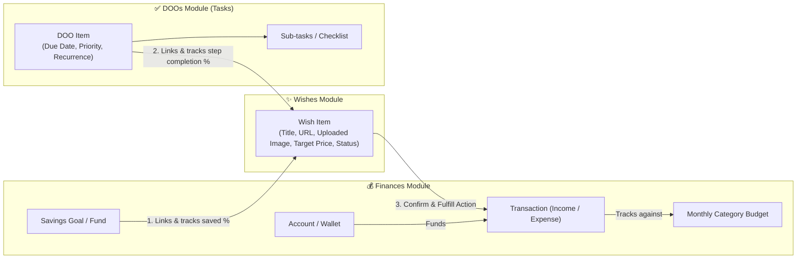
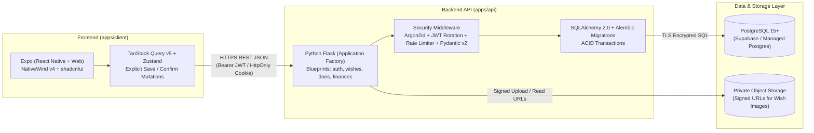
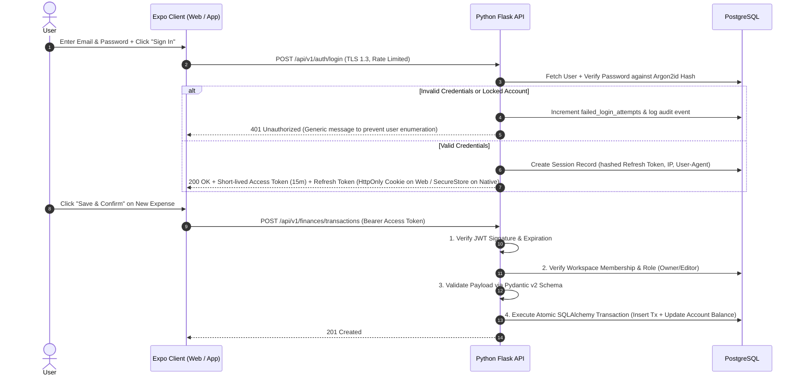
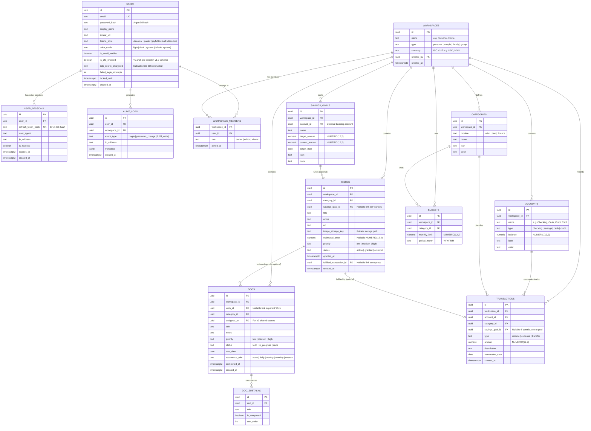
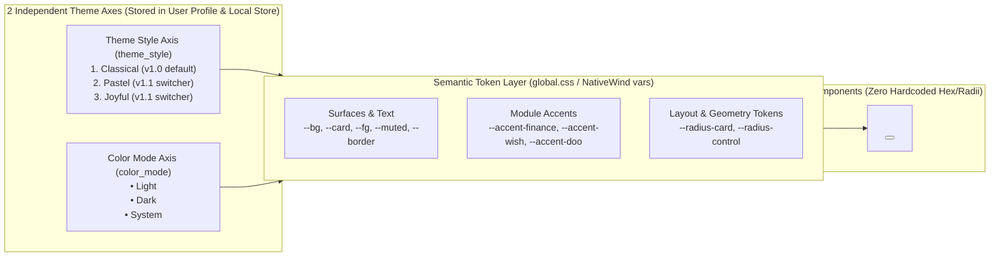

# WishesAndDOOs — Application Context, Software Architecture & Design Document

> **Status:** Draft v2.0 (Modular Python Flask API + Strong Security Architecture)  
> **Scope:** v1.0 Personal Release (Architected for v2.0 Shared Spaces for Couples, Families & Small Groups)  
> **Target Surface:** Universal Web/PWA first (Desktop & Mobile Browser), Mobile-ready via Expo (iOS & Android)

---

## 1. Product Vision & Application Context

**WishesAndDOOs** is a modern, simple, and approachable unified workspace that brings together three everyday pillars of life planning:
1. **Wishes (Wishlist & Goals):** Things you want to buy, experience, or achieve, complete with estimated cost, links, uploaded images, and progress tracking.
2. **DOOs (Tasks, Habits & Sub-tasks):** Actionable to-dos, recurring habits/chores, and checklists—which can stand alone or be linked directly to a parent **Wish** as steps required to achieve it.
3. **Finances (Income, Expenses, Budgets & Savings Goals):** Clean, friction-free financial tracking with wallets/accounts, monthly category budgets, and **Savings Goals (Funds)** that can link directly to **Wishes**, anchored by a **Finance-focused Overview Dashboard**.

### 1.1 Phased Rollout Strategy
| Phase | Target Audience | Scope Summary |
| :--- | :--- | :--- |
| **v1.0 (MVP Release)** | **Personal / Solo Use** | Single-user personal workspace with explicit **Save / Confirm** workflows. Full Wishes, DOOs, and Finances modules with cross-linking, Finance-focused Overview panel, Light/Dark mode, and foundational multi-theme CSS token engine. |
| **v1.1 (Polish & Security)** | **Personal / Solo Use** | Interactive **Theme & Layout Style Switcher** (`Classical`, `Pastel`, `Joyful` × `Light`/`Dark`) and **TOTP 2FA** setup UI (both pre-wired in v1.0 schema & token engine). |
| **v2.0 (Expansion)** | **Couples, Families & Small Groups** | Shared workspaces, member invitations, role-based access, shared wishlists, assigned household DOOs, and shared budgets/split expenses. |

> [!IMPORTANT]
> **Architectural Golden Rule for v1 → v2 Transition:**  
> Even though v1 is strictly for personal use, **every database record (Wish, DOO, Account, Transaction, Budget, Savings Goal) belongs to a `workspace_id`** rather than only a `user_id`. On signup in v1, a default `"Personal Workspace"` is automatically created for the user. When v2 launches, enabling shared spaces for couples or families requires **zero database migrations or query rewrites**—only adding a UI to invite members to a workspace.

---

## 2. Domain Model & Cross-Module Interactions

The three modules (**Wishes**, **DOOs**, **Finances**) operate as independent, clutter-free tabs within a workspace, while supporting intentional, high-value bridges between them:



### Key Cross-Module Workflows
1. **Wish ↔ Finances (Savings & Fulfillment):**
   - A **Wish** with an estimated price (e.g., *"Espresso Machine — $650"*) can optionally be linked to a **Savings Goal / Fund** in Finances. Adding money to that Savings Goal updates the Wish's funding progress bar.
   - Clicking **Confirm & Fulfill Wish** offers a toggle: *"Log as an expense in Finances?"*, executing an atomic database transaction in Flask that marks the Wish `granted`, creates the `expense` transaction, and deducts the amount from the chosen `Account`.
2. **Wish ↔ DOOs (Actionable Breakdown):**
   - A **Wish** (e.g., *"Trip to Japan"* or *"Home Office Upgrade"*) can have linked **DOOs** (e.g., *"Renew passport"*, *"Measure desk space"*). Completing those DOOs updates the Wish's action progress.
3. **Standalone Simplicity:**
   - Users are never forced to link items. A quick task in **DOOs**, a quick expense in **Finances**, or a simple item on the **Wishlist** is saved via an explicit **Save / Confirm** button.

---

## 3. Modular System Architecture & Technology Stack



### 3.1 Frontend Stack (`apps/client`)

| Layer | Technology | Rationale |
| :--- | :--- | :--- |
| **Core Framework** | **Expo (React Native + React Native Web) + TypeScript** | Single universal codebase targeting **Web/PWA first** and native iOS/Android with zero duplication. |
| **Routing & Navigation** | **Expo Router (v4)** | File-based, type-safe URL routing (`/(app)/wishes`, `/(app)/doos`, `/(app)/finances`). |
| **Styling Engine** | **NativeWind v4 (Tailwind CSS)** | Standard Tailwind CSS utility classes and CSS variables across Web and Native with dark/light mode. |
| **UI Component System** | **React Native Reusables (`shadcn/ui` for RN) + `@rn-primitives`** | Brings `shadcn/ui` ownership and accessible Radix-like primitives (`Dialog`, `Popover`, `Select`, `Tabs`, `Checkbox`) to React Native + Web. |
| **Icons** | **`@expo/vector-icons` (`MaterialIcons`)** | Clean, consistent Material Design vector icons across Web and Native without external SVG peer conflicts. |
| **API Client & State** | **TanStack Query v5 + Typed Fetch Client + Zustand** | Explicit **Save / Confirm** mutations with loading spinners, error handling, and cache invalidation. |

### 3.2 Backend Stack (`apps/api` — Python Flask)

| Layer | Technology | Rationale |
| :--- | :--- | :--- |
| **Web Framework** | **Python 3.12+ & Flask 3.x (Application Factory Pattern)** | Modular **Flask Blueprints** (`auth`, `workspaces`, `wishes`, `doos`, `finances`), clean service-repository architecture, easy to test and maintain. |
| **ORM & Migrations** | **SQLAlchemy 2.0 (Typed) + Alembic** | Industry-standard Python ORM with full ACID transaction control (`with db.session.begin():`) and versioned schema migrations. |
| **Validation & Serialization** | **Pydantic v2** | Strict request/response schema validation, automatic type coercion, and protection against mass-assignment / injection. |
| **Password Hashing** | **`argon2-cffi` (Argon2id)** | Winner of the Password Hashing Competition and OWASP's #1 recommendation—resistant to GPU/ASIC cracking. |
| **Auth & Tokens** | **`PyJWT` / `Flask-JWT-Extended` + Rotating Refresh Tokens** | Short-lived Access Tokens (15 min) + revocable Refresh Tokens stored as SHA-256 hashes in PostgreSQL. |
| **API Security & Hardening** | **`Flask-Limiter` + `Flask-Talisman` + `Flask-CORS`** | Brute-force rate limiting, strict CORS, HSTS, and secure HTTP headers. |
| **Database & Storage** | **PostgreSQL 15+ & Private S3/Supabase Storage** | Relational integrity with `NUMERIC(12, 2)` for finances, plus private bucket storage for Wish images. |

---

## 4. Strong Security & Authentication Architecture

Because **WishesAndDOOs** stores personal financial balances, transactions, and private goals, security is designed using **Defense-in-Depth**:



### 4.1 Authentication Safeguards
1. **Argon2id Password Hashing:** Passwords are never stored or logged in plaintext. We use **Argon2id** (`argon2-cffi`) with tuned memory, iteration, and parallelism parameters, plus a minimum password strength policy (10+ characters, checked against common breached password patterns).
2. **Short-Lived Access Tokens + Database-Backed Refresh Token Rotation:**
   - **Access Token (15 minutes):** Used to authorize API requests. If stolen, it expires quickly.
   - **Refresh Token (7–30 days, Rotated on every use):** Stored as a cryptographic hash in the `user_sessions` table. Every time a refresh token is used to get a new access token, the old refresh token is invalidated and replaced (**Refresh Token Rotation**). If a reused token is detected, the entire token family is revoked immediately.
   - **Session Management ("Log out all devices"):** Because active sessions are tracked in `user_sessions`, users can view active devices and revoke any session immediately.
3. **Web vs. Mobile Token Storage:**
   - **On Web:** Refresh tokens are stored in **`HttpOnly`, `Secure`, `SameSite=Strict` cookies** (inaccessible to JavaScript/XSS), with CSRF protection.
   - **On Mobile (iOS/Android later):** Stored in hardware-backed encrypted storage (`expo-secure-store` — iOS Keychain / Android Keystore).
4. **Brute-Force & Account Lockout Protection:**
   - `Flask-Limiter` enforces strict rate limits on `/auth/login`, `/auth/register`, and `/auth/reset-password` (e.g., 5 attempts per minute per IP and email).
   - Temporary exponential cooldown after repeated failed login attempts on an account.
5. **Optional Two-Factor Authentication (TOTP 2FA Ready):**
   - The `users` table includes `totp_secret_encrypted` and `is_2fa_enabled` columns so users can optionally enable Authenticator App (Google Authenticator / 1Password / Authy) 2FA using `pyotp`.

### 4.2 Authorization & Data Protection
1. **Strict Workspace Isolation (`@require_workspace_role`):**
   - Every resource endpoint (`/api/v1/workspaces/<workspace_id>/wishes`, `/finances`, `/doos`) passes through a Flask security decorator that verifies the authenticated user belongs to `<workspace_id>` in `workspace_members` and prevents Insecure Direct Object Reference (IDOR) attacks.
2. **Application-Level Encryption for Sensitive Fields (Optional / Configurable):**
   - Using Python's `cryptography` (`AES-256-GCM` / `Fernet`), sensitive fields (such as TOTP secrets or private financial account notes) are encrypted with a server-side master key before being written to PostgreSQL.
3. **Secure Image Uploads:**
   - Users never upload executable files or public buckets:
     1. Flask validates file size (`≤ 5 MB`) and verifies actual file magic bytes (`image/jpeg`, `image/png`, `image/webp`).
     2. Images are re-encoded/stripped of EXIF GPS metadata using `Pillow` (so uploading a photo taken at home never leaks GPS coordinates).
     3. Stored in a **private storage bucket** under `<workspace_id>/<uuid>.webp` and served only via short-lived **Signed URLs**.
4. **Security Audit Log (`audit_logs` table):**
   - Security-critical events (login, failed login, password change, session revocation, workspace member changes) are recorded with `user_id`, `ip_address`, `user_agent`, and `created_at`.

---

## 5. Database Schema & Entity-Relationship Design (PostgreSQL)



---

## 6. Modular Repository Folder Structure

```text
WishesAndDOOs/
├── apps/
│   ├── client/                       # Universal Frontend (Expo Router + NativeWind v4 + shadcn/ui)
│   │   ├── app/                      # File-based routes
│   │   │   ├── _layout.tsx           # Root providers (TanStack Query, Theme, Auth Guard)
│   │   │   ├── (auth)/               # /login, /register
│   │   │   └── (app)/                # Authenticated Adaptive Shell
│   │   │       ├── index.tsx         # Finance-Focused Overview Dashboard + Wishes/DOOs Summary
│   │   │       ├── wishes/           # Wishes module screens
│   │   │       ├── doos/             # DOOs module screens (List, Today, Upcoming, Calendar)
│   │   │       ├── finances/         # Finances module (Transactions, Budgets, Savings Goals, Accounts)
│   │   │       └── settings/         # Profile, Security (Sessions/Password), Workspace settings
│   │   ├── src/
│   │   │   ├── api/                  # Modular HTTP client & endpoint services (auth, wishes, doos, finances)
│   │   │   ├── components/
│   │   │   │   ├── ui/               # React Native Reusables (shadcn/ui components)
│   │   │   │   └── layout/           # AdaptiveShell, PageHeader, ConfirmModal
│   │   │   └── features/             # Domain UI & TanStack Query hooks per module
│   │   ├── global.css
│   │   └── tailwind.config.js
│   │
│   └── api/                          # Modular Python Flask Backend API
│       ├── app/
│       │   ├── __init__.py           # Flask Application Factory (create_app)
│       │   ├── config.py             # Environment & Security configuration
│       │   ├── extensions.py         # SQLAlchemy, Alembic, Limiter, CORS, Talisman init
│       │   ├── core/
│       │   │   ├── security.py       # Argon2id hashing, JWT creation/verification, AES encryption
│       │   │   ├── decorators.py     # @require_auth, @require_workspace_role
│       │   │   └── storage.py        # Pillow EXIF stripping + Private Bucket Signed URLs
│       │   └── modules/              # Domain-Driven Flask Blueprints
│       │       ├── auth/             # routes.py, service.py, schemas.py, models.py (Users, Sessions, Audit)
│       │       ├── workspaces/       # routes.py, service.py, schemas.py, models.py
│       │       ├── wishes/           # routes.py, service.py, schemas.py, models.py
│       │       ├── doos/             # routes.py, service.py, schemas.py, models.py
│       │       └── finances/         # routes.py, service.py, schemas.py, models.py (Overview, Tx, Budgets, Goals)
│       ├── migrations/               # Alembic database migrations
│       ├── tests/                    # Pytest unit & integration tests (auth, RBAC, financial atomicity)
│       ├── pyproject.toml            # Python dependencies
│       └── wsgi.py                   # Entrypoint
├── docker-compose.yml                # Local Dev Environment (PostgreSQL 15 + Local Object Storage)
└── docs/
    └── ARCHITECTURE.md               # This architecture document
```

---

## 7. Multi-Theme & Design System Architecture (v1.0 Foundation → v1.1 Switcher)

To ensure that **v1.1's Theme & Layout Switcher** (`Classical`, `Pastel`, `Joyful` × `Light` / `Dark`) works with **zero component refactoring**, v1.0 enforces a strict **3-Layer Semantic Token Architecture** powered by CSS Variables and NativeWind v4 `vars()`.

### 7.1 How the Two-Axis Theme Engine Works



> [!IMPORTANT]
> **Component Rule from Day 1 (v1.0):**  
> Components **never** use raw Tailwind colors (like `bg-zinc-900`, `text-emerald-600`, or `rounded-xl`). Instead, every component uses semantic tokens (`bg-card`, `text-finance`, `rounded-card`). Switching between `Classical`, `Pastel`, and `Joyful` in v1.1 simply swaps the active token dictionary in `ThemeProvider`.

### 7.2 The 3 Minimalist Theme Presets (Light & Dark Tokens)

All three themes share the same **clean, uncluttered minimalist layout** and **4.5:1+ WCAG contrast compliance**, while expressing distinct personalities through surface warmth, accent saturation, and corner geometry:

| Semantic Token | 1. Classical Minimalist *(Notion / Linear / Wise)* | 2. Pastel Minimalist *(Soft Nordic Calm)* | 3. Joyful Minimalist *(Warm Vibrant Modern)* |
| :--- | :--- | :--- | :--- |
| **Vibe & Geometry** | Crisp, editorial, understated<br>`--radius-card: 10px`<br>`--radius-control: 8px` | Airy, gentle, soothing<br>`--radius-card: 16px`<br>`--radius-control: 12px` | Energetic, friendly, uplifting<br>`--radius-card: 20px`<br>`--radius-control: 9999px (pill)` |
| **`--background` (Light / Dark)** | `#FAF9F6` / `#0C0D10` | `#FDFBF9` / `#13141C` | `#FFFDF7` / `#0F111A` |
| **`--card` (Light / Dark)** | `#FFFFFF` / `#14161B` | `#FFFFFF` / `#1B1D28` | `#FFFFFF` / `#181B26` |
| **`--muted` (Light / Dark)** | `#F3F2EE` / `#1E2028` | `#F5F0F6` / `#252836` | `#FFF5EB` / `#232736` |
| **`--foreground` (Light / Dark)** | `#18181B` / `#F4F4F5` | `#27272A` / `#F4F4F6` | `#1C1917` / `#FAFAF9` |
| **`--border` (Light / Dark)** | `#E6E4DD` / `#262932` | `#EDE8F0` / `#2E3244` | `#F5E6D3` / `#2D3246` |
| **`--primary` (Light / Dark)** | `#18181B` / `#F4F4F5` | `#5B5BD6` (Soft Iris) / `#A5B4FC` | `#F97316` (Warm Coral) / `#FB923C` |
| **`--finance` Accent (Light / Dark)** | `#059669` / `#34D399` | `#2E9075` (Sage Mint) / `#6EE7B7` | `#10B981` (Emerald Pop) / `#34D399` |
| **`--wish` Accent (Light / Dark)** | `#7C3AED` / `#A78BFA` | `#9353D3` (Soft Lilac) / `#C084FC` | `#EC4899` (Vibrant Rose) / `#F472B6` |
| **`--doo` Accent (Light / Dark)** | `#2563EB` / `#60A5FA` | `#3B82F6` (Periwinkle) / `#93C5FD` | `#0284C7` (Sunny Cobalt) / `#38BDF8` |

### 7.3 Typography & Explicit Save UX
- **Primary Sans (`Plus Jakarta Sans` / `Inter`):** Clean, approachable hierarchy across all 3 themes.
- **Monospace / Tabular Numerals (`JetBrains Mono` or `tabular-nums`):** Mandatory for all currency figures, account balances, and budget percentages.
- **Explicit Save / Confirm Pattern:** Every creation, edit, or fulfillment modal features a clear **"Save & Confirm"** primary action with disabled/loading states while the Flask API processes the request, followed by a subtle confirmation toast.

---

## 8. Confirmed Architecture & Roadmap Summary

| Area | Decision |
| :--- | :--- |
| **Frontend (`apps/client`)** | Universal Expo (React Native + Web/PWA) + Expo Router + NativeWind v4 + React Native Reusables (`shadcn/ui`) + TanStack Query |
| **Backend (`apps/api`)** | Modular Python Flask (Blueprints + Application Factory) + SQLAlchemy 2.0 + Alembic + Pydantic v2 |
| **Local Dev Infrastructure** | `docker-compose.yml` running PostgreSQL 15+ and local volume/object storage |
| **Authentication & Security** | Email + Password with **Argon2id**, short-lived JWT Access Tokens (15m) + rotating hashed Refresh Tokens (`user_sessions`), `Flask-Limiter` brute-force protection, EXIF stripping on private Wish image uploads, and TOTP 2FA columns pre-wired in schema for v1.1 |
| **Theme Engine** | 2-Axis Semantic Token System (`theme_style`: `classical`/`pastel`/`joyful` × `color_mode`: `light`/`dark`/`system`) built in v1.0 (`classical` default) for zero-refactor Theme Switcher in v1.1 |

---

## 9. Screen Inventory, Navigation Map & Screen-by-Screen Construction Plan

We will construct **WishesAndDOOs** **Screen by Screen (10 Screens Total)** using a strict **Mobile-First Approach (`390×844` base viewport first)**. Each screen slice includes all backend database migrations, Flask API endpoints, automated tests (`pytest` + frontend checks), and the mobile-first UI needed so you can immediately test and tune that screen before we move to the next one.

### 9.1 Application Navigation Flow

```mermaid
flowchart TD
    START(("App Launch")) --> AUTH_CHECK{"Authenticated?"}
    AUTH_CHECK -->|"No"| S1["Screen 1: Welcome / Landing\n(/welcome)"]
    S1 -->|"Sign In"| S2["Screen 2: Login\n(/login)"]
    S1 -->|"Get Started"| S3["Screen 3: Register\n(/register)"]
    S2 <--> S3

    AUTH_CHECK -->|"Yes"| SHELL["Authenticated App Shell\n(4 Bottom Tabs + Top Header Avatar)"]
    S2 -->|"Success"| SHELL
    S3 -->|"Creates Personal Workspace"| SHELL

    SHELL --> S4["Screen 4 (Tab 1): Dashboard / Overview\n(/dashboard)"]
    SHELL --> S5["Screen 5 (Tab 2): Finances\n(/finances)\nPills: Transactions | Budgets | Goals | Accounts"]
    SHELL --> S6["Screen 6 (Tab 3): Wishes List\n(/wishes)"]
    SHELL --> S8["Screen 8 (Tab 4): DOOs List & Calendar\n(/doos)\nPills: Today | Upcoming | All | Calendar"]
    SHELL -->|"Header Avatar"| S10["Screen 10: Profile & Settings\n(/settings)"]

    S6 -->|"Tap Wish Card"| S7["Screen 7: Wish Detail\n(/wishes/[id])\n+ Confirm & Fulfill Modal"]
    S8 -->|"Tap DOO Item"| S9["Screen 9: DOO Detail\n(/doos/[id])\n+ Sub-tasks Checklist"]
    S7 -.->|"Tap Linked DOO"| S9
    S7 -.->|"Logs Expense on Fulfill"| S5
```



---

### 9.2 The "Build → Auto-Test → Live User Review" Loop (Applied to Every Screen)

1. **Build Full-Stack Screen Slice:** Implement the required PostgreSQL tables, Flask endpoints/services, and Mobile-First Expo screen (`390×844` base, `≥ 44×44px` touch targets, semantic theme tokens).
2. **Automated Testing Gate:** Run `pytest` on the new Flask endpoints/security rules + TypeScript/component tests + live mobile viewport render check.
3. **Interactive Review & Live Tuning:** Leave Docker Postgres + Flask API + Expo running with seeded data and the **Dev Theme Preview Bar** so you can test the screen yourself, adjust colors/layout/functionality, and approve it before we move to the next screen.

---

### 9.3 Screen-by-Screen Construction Order (10 Screens)

| Step | Screen & Route | Backend & Infrastructure Constructed (`apps/api`) | Mobile-First UI Constructed (`apps/client`) | What You Will Test & Tune Live |
| :--- | :--- | :--- | :--- | :--- |
| **Screen 1** | **Welcome / Landing Screen**<br>`/welcome` | `docker-compose.yml` (PostgreSQL 15), Flask App Factory, `/api/v1/health`, CORS & Security headers. | Expo Router setup, NativeWind v4 + **2-Axis Theme Engine** (`Classical`/`Pastel`/`Joyful` × `Light`/`Dark`), core `shadcn/ui` primitives, **Welcome Screen** hero, value cards, Light/Dark toggle, **"Get Started"** & **"Sign In"** buttons, plus a **Dev Theme Preview Toggle**. | Test the Welcome Screen mobile layout, typography, Light/Dark mode, and preview the 3 theme palettes live. |
| **Screen 2** | **Login Screen**<br>`/login` | `USERS`, `USER_SESSIONS`, `AUDIT_LOGS`, `WORKSPACES`, `WORKSPACE_MEMBERS` tables; Argon2id hashing; `/auth/login`, `/auth/refresh`, `/auth/logout`, `/auth/me`; `Flask-Limiter` rate limiting; seeded demo account (`demo@wishesanddoos.app`). | **Login Screen** with Email & Password inputs, show/hide password toggle, inline validation, rate-limit/error alert banner, **"Sign In"** loading state, and navigation to Register / Welcome. | Sign in with the seeded demo account, test invalid password errors & brute-force rate limiting, and adjust Login UI/colors. |
| **Screen 3** | **Register Screen**<br>`/register` | `/auth/register` endpoint (Pydantic validation, Argon2id hashing, atomic creation of User + default `"Personal Workspace"` + default categories). | **Register Screen** with Display Name, Email, Password, Confirm Password, live password strength indicator, and explicit **"Create Account"** button. | Create a brand-new user account end-to-end, test password strength rules, and tune the Register form layout. |
| **Screen 4** | **Dashboard / Overview Screen & App Shell**<br>`/(app)/dashboard` | `/dashboard/overview` aggregation endpoint + seeded demo financial/wish/task summary data. | **Authenticated Shell** (4 Mobile Bottom Tabs: *Dashboard*, *Finances*, *Wishes*, *DOOs* + Top Header with **Settings Avatar**; Desktop Sidebar); **Dashboard Screen** showing Total Net Balance, Monthly Income vs. Expense card, Budget Health bars, Savings Goals preview, and quick peek cards for Top Wishes & Today's DOOs. | Test the 4-tab mobile navigation bar, header avatar, and tune the Finance-focused Dashboard cards, hierarchy, and colors. |
| **Screen 5** | **Finances Screen**<br>`/(app)/finances` | `ACCOUNTS`, `CATEGORIES`, `TRANSACTIONS`, `BUDGETS`, `SAVINGS_GOALS` tables & atomic CRUD endpoints (auto-updating account balances & goal progress). | **Finances Screen** with 4 top pill-tabs:<br>1. **Transactions** (+ Add/Edit Expense/Income Bottom Sheet)<br>2. **Budgets** (+ Set Monthly Category Limit Bottom Sheet)<br>3. **Savings Goals** (+ Create/Fund Goal Bottom Sheet)<br>4. **Accounts** (+ Add/Edit Wallet Bottom Sheet)<br>All modals use explicit **"Save & Confirm"** buttons. | Switch between the 4 Finance pill-tabs, add wallets, log transactions, set monthly budgets, fund savings goals, and verify Dashboard updates. |
| **Screen 6** | **Wishes List Screen**<br>`/(app)/wishes` | `WISHES` table, private image upload endpoint (`Pillow` EXIF stripping + signed URLs), `/wishes` CRUD endpoints. | **Wishes List Screen** with status/priority filters, mobile-first Wish cards (uploaded image, title, target price, linked Savings Goal progress bar, linked DOOs step count) + **Quick Add Wish Bottom Sheet** (with image upload picker & **Save & Confirm**). | Upload Wish images, link a Wish to a Savings Goal from Screen 5, and tune the Wish card design. |
| **Screen 7** | **Wish Detail Screen**<br>`/(app)/wishes/[id]` | `/wishes/<id>` detail endpoint & atomic `/wishes/<id>/fulfill` endpoint (marks Wish `granted`, creates Expense in `TRANSACTIONS`, deducts `ACCOUNTS` balance). | **Wish Detail Screen** with full image header, priority/category badges, notes, external URL link, linked Savings Goal card, linked DOOs list, Edit Wish sheet, and the **"Confirm & Fulfill Wish"** modal. | Tap into a Wish, edit its details, and test fulfilling a Wish into a real Finance expense transaction. |
| **Screen 8** | **DOOs List & Calendar Screen**<br>`/(app)/doos` | `DOOS` & `DOO_SUBTASKS` tables, recurrence rule engine (`none`, `daily`, `weekly`, `monthly`), `/doos` list/filter/complete endpoints. | **DOOs Screen** with 4 view pills (*Today* | *Upcoming* | *All* | *Calendar*), mobile-first task rows with checkbox completion, priority/recurrence badges, and **Quick Add DOO Bottom Sheet** (with optional link to a parent Wish & **Save & Confirm**). | Create standalone and Wish-linked DOOs, test the Today/Upcoming/Calendar views, and complete recurring tasks. |
| **Screen 9** | **DOO Detail Screen**<br>`/(app)/doos/[id]` | `/doos/<id>` detail & `/doos/<id>/subtasks` CRUD/toggle endpoints (auto-updating parent Wish action progress). | **DOO Detail Screen** with status/priority/due-date header, recurrence indicator, linked parent Wish card, interactive **Sub-tasks / Checklist** manager (add, toggle, delete steps), and Edit/Delete DOO controls. | Tap into a DOO, add/check off sub-tasks, and verify that linked Wish completion % updates automatically. |
| **Screen 10** | **Profile & Settings Screen**<br>`/(app)/settings` | `/settings/profile`, `/auth/change-password`, `/auth/sessions` (list & revoke active device sessions), `/workspaces/current` (currency & name). | **Profile & Settings Screen** (opened from the Top Header Avatar): Display Name, Workspace Currency selector, **Appearance Card** (Light/Dark/System toggle + v1.1 Theme Style selector preview), **Security Card** (Change Password + Active Sessions list with "Revoke" buttons), and **Sign Out**. | Change workspace currency, test Light/Dark/Theme switching from Settings, revoke sessions, and test full Sign Out → Login loop. |


